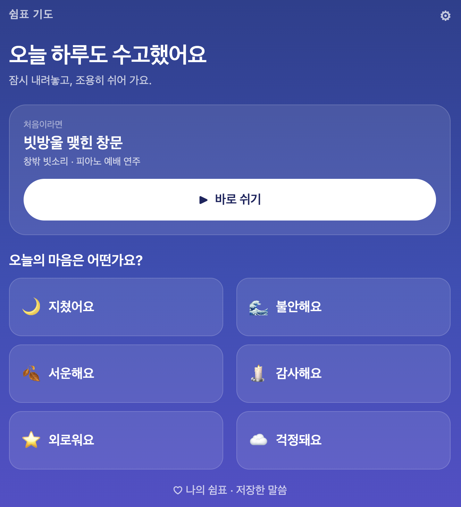
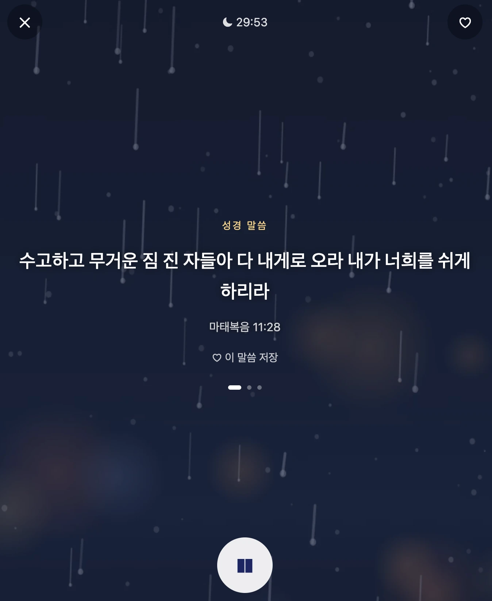
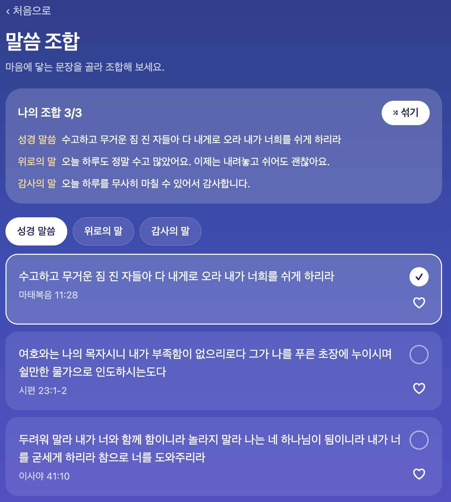
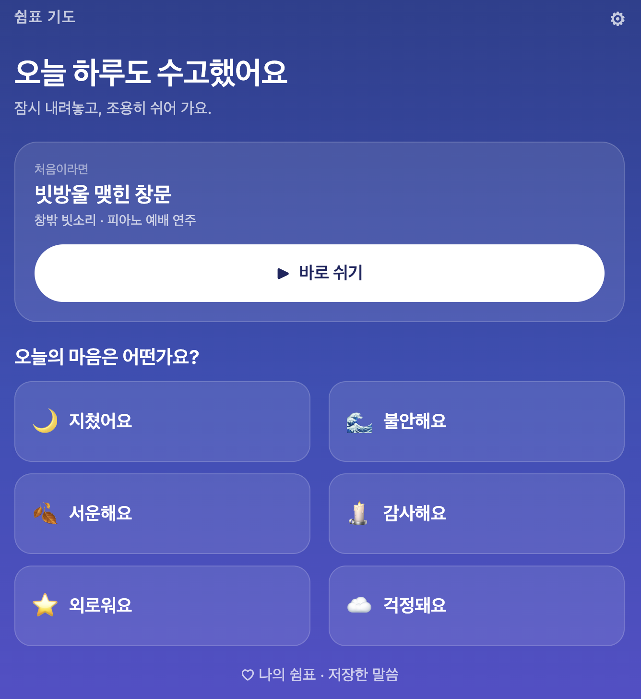

<p align="center">
  
  
  
  
</p>

# 쉼표 기도 (MVP)

유독 힘든 날 퇴근 후, 짧은 말씀 몇 줄과 잔잔한 소리·배경 화면으로 10분 동안 몸과 마음을 가라앉히는 앱입니다.
교회에 다니는 25~45세 직장인을 위해 만들었습니다. **비행기 탑승 모드(인터넷 없음)에서도 모든 무료 기능과 이미 산 유료 팩이 그대로 동작**하는 것이 핵심 조건입니다.

- 앱 틀: Expo SDK 57 + Expo Router (React Native 0.86, TypeScript)
- 소리 `expo-audio` · 배경 영상 `expo-video` · 이미지 `expo-image` · 저장 `AsyncStorage` · 결제 RevenueCat(`react-native-purchases`)

## 실행 방법

```bash
npm install
npx expo start          # 휴대폰의 Expo Go 또는 웹(w)으로 확인
npx tsc --noEmit        # 타입 검사
npx expo lint           # 린트
```

결제(RevenueCat)는 Expo Go에서 동작하지 않으므로 개발 빌드(`npx expo run:ios` 또는 `eas build --profile development`)가 필요합니다.
`.env.example`을 `.env`로 복사해 RevenueCat 키를 넣습니다. 키가 없으면 개발 중에만 **테스트 구매**로 잠금 해제를 흉내 냅니다.

## 이번 작업의 주요 내용

### 기능 (명세서 F1~F9)

| ID | 기능 | 구현 위치 |
|---|---|---|
| F1 | 오늘의 마음 6개(지쳤어요·불안해요·서운해요·감사해요·외로워요·걱정돼요) → 맞는 말씀이 먼저 보임 | `app/index.tsx`, `suggestVerses()` |
| F2 | 성경·위로·감사에서 각 0~1개, 최대 3장 조합 + 섞기 | `app/words.tsx` |
| F3 | 배경 위에 말씀을 큰 글씨로 한 장씩, 20초마다 또는 탭하면 다음 카드 | `app/rest.tsx` |
| F4 | 소리 8개 믹서, 소리별 볼륨, 동시 재생 무료 2개 / 팩 5개 | `app/mixer.tsx`, `src/audio/mixer.ts` |
| F5 | 배경 이미지 6개 + 영상 6개(소리 없이 반복) | `app/mixer.tsx` |
| F6 | 수면 타이머 10·20·30분·1시간·끄지 않음, 끝나기 30초 전부터 소리·화면 페이드 | `app/rest.tsx` |
| F7 | "나의 쉼표"(말씀+소리+배경) 저장(무료 3개) + 말씀 하나만 따로 저장 | `app/favorites.tsx` |
| F8 | 고요한 밤 팩(`pack_quiet_night`, 권한 `quiet_night`) 1회 구매·구매 복원 | `app/store.tsx`, `src/purchases.ts` |
| F9 | 백그라운드·잠금화면 재생 설정 (P1) | `src/audio/mixer.ts`, `app.json` |

- **3번 안에 소리:** 마음 고르기 → "다음"을 누르면 믹서 화면에서 바로 소리가 납니다. 두 번째 방문부터는 **"지난번처럼"** 한 번으로 쉼 화면에 들어갑니다.
- **잠긴 콘텐츠:** 잠긴 소리를 누르면 10초 미리듣기와 팩 안내가 나옵니다. 쉼 화면에는 구매 안내를 띄우지 않습니다.
- **오프라인:** 모든 소리·이미지·영상·말씀을 `require()`로 앱 안에 포함했습니다. 인터넷을 쓰는 코드는 `src/purchases.ts`뿐이고, 구매 목록은 기기에 저장해 오프라인에서도 잠금이 풀린 상태를 유지합니다. 새 팩 구매 시 연결이 없으면 "구매는 인터넷 연결 후 가능해요"라고 안내합니다.
- **설정:** 기본 타이머, 쉼 화면 밝기, 말씀 글자 크기, 만든 사람·출처 페이지(`app/settings.tsx`).

### 콘텐츠

| 종류 | 내용 | 확보 방법 |
|---|---|---|
| 소리 8개 (무료 5 + 팩 3) | 빗소리·파도·벽난로·밤 숲 / 피아노·앰비언트·기타·오르골 | 자연음 4개는 코드로 합성(`tools/gen_ambient.swift`), 음악 4개는 직접 만든 CCM 합성 음원을 AAC(.m4a)로 변환 |
| 배경 이미지 6 + 영상 6 | 빗방울 창문·밤바다·촛불·별하늘 / 안개 숲길·모닥불(팩) | 코드로 직접 그림(`tools/gen_visuals.swift`), 영상은 720×1280 H.264 16초 무음 루프 |
| 말씀 90개 (무료 40 + 팩 50) | 성경 40 · 위로 25 · 감사 25, 마음 태그 1~2개 | 성경은 개역한글 본문, 위로·감사는 직접 작성 (`assets/content/verses.json`) |

모든 파일의 출처·라이선스는 `assets/credits.json`에 기록했습니다. 코드로 만든 콘텐츠는 출시 전에 실제 녹음본이나 Pexels·Pixabay 자료로 바꿀 수 있는 **임시 자료**입니다.

### 프로젝트 구조

```
app/                    # 화면 (Expo Router)
  _layout.tsx           # 전체 내비게이션, 오디오 모드 초기화
  index.tsx             # 홈: 오늘의 마음, 지난번처럼
  words.tsx             # 말씀 조합
  mixer.tsx             # 소리 믹서 + 배경 고르기 + 타이머
  rest.tsx              # 쉼 화면 (배경 + 말씀 + 타이머)
  favorites.tsx         # 나의 쉼표, 저장한 말씀
  store.tsx             # 콘텐츠 팩
  settings.tsx          # 설정, 만든 사람·출처
src/
  audio/mixer.ts        # 플레이어 관리, 볼륨, 페이드, 잠금화면 연동, 미리듣기
  data/catalog.ts       # 소리·배경·마음 목록과 require() 연결
  data/storage.ts       # AsyncStorage 읽기·쓰기
  data/types.ts         # 데이터 모델
  state/AppState.tsx    # 앱 상태 (지금 설정 + 저장된 사용자 데이터)
  purchases.ts          # RevenueCat, 구매 목록 캐시
  ui/                   # 공통 컴포넌트, 테마, 안내 시트
assets/  audio/ images/ videos/ content/verses.json  credits.json
tools/                  # 소리·배경을 다시 만드는 Swift 스크립트
CLAUDE.md               # AI에게 주는 프로젝트 규칙 (명세서 요약)
```

## 오류 수정 사항

| 문제 | 원인 | 수정 |
|---|---|---|
| 쉼 화면에서 배경 영상이 첫 프레임에서 멈춤 (웹) | `useVideoPlayer` 초기 설정에서 호출한 `play()`가 영상이 화면에 붙기 전이라 무시됨 | 화면에 붙은 뒤와 `statusChange`가 `readyToPlay`일 때 한 번 더 `play()` 호출 (`app/rest.tsx`) |
| 쉼 화면에서 탭·저장·닫기 버튼이 반응하지 않음 | 타이머 끝에 화면을 어둡게 하는 투명 층의 `pointerEvents` prop이 웹에서 무시되어 모든 터치를 가로챔 | `pointerEvents`를 style 안으로 옮김 |
| 린트 오류: 렌더 중 ref 접근 (`react-hooks/refs`) | `useRef(new Animated.Value()).current` 패턴 | `useState(() => new Animated.Value())`로 변경 |
| 타입 오류: `StyleSheet.absoluteFillObject` 없음 | RN 0.86에서 제거됨 | position 값을 직접 지정 |
| `expo-doctor`: 필수 peer dependency 누락 | `expo-audio`가 `expo-asset`을 요구 | `npx expo install expo-asset` |
| 라우트 파일에서 default 외 export 경고 | `mixer.tsx`에서 `timerLabel` 등을 export | 공용 함수는 `src/data/catalog.ts`로 이동 |
| 잠금화면 정지 시 일부 소리만 멈춤 | 잠금화면은 플레이어 하나만 제어 가능 | 대표 플레이어 상태 변화를 감지해 나머지 플레이어도 함께 재생/정지 (`src/audio/mixer.ts`) |

## 남은 일 (실제 기기 확인 필요)

- [ ] 소리 3개 동시 재생 + 화면 끔 상태로 1시간 재생 시 끊김 없음 (iOS·안드로이드)
- [ ] 잠금화면 재생·정지, 전화·알람 뒤 재생 이어짐
- [ ] 타이머 종료 시 소리가 서서히 작아지고 완전히 멈춤
- [ ] 개발 빌드 + 샌드박스 계정으로 구매·복원, 구매 후 비행기 모드 재실행
- [ ] 성경 본문을 개역한글 원문과 대조 교정, 번역본 사용 조건 대한성서공회 확인
- [ ] 위로·감사 문구 목회자 검토
- [ ] 한글 폰트 파일 포함 (현재 시스템 폰트 사용)
- [ ] 합성 음원·코드 배경을 고품질 녹음본·사진/영상으로 교체 후 `credits.json` 갱신
